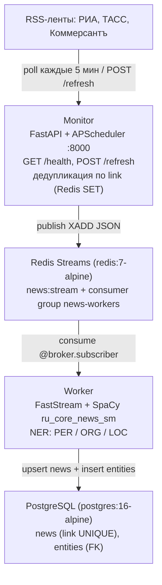

# News Monitor — event-driven мониторинг новостей с NER

Система мониторинга новостей из RSS-лент российских информационных агентств с
извлечением именованных сущностей (PER, ORG, LOC) и записью в PostgreSQL.
Полностью локальная, без платных внешних API.

Стек: Python 3.12, UV, ruff, FastAPI, APScheduler, FastStream, SpaCy,
`ru_core_news_sm`, Redis (Streams), PostgreSQL, Docker Compose.

## Архитектура



## Компоненты

- `monitor/` — опрос RSS-лент и публикация в очередь (`main.py`, `rss.py`, `publisher.py`).
- `worker/` — чтение из очереди, NER, запись в БД (`main.py`, `db.py`, `ner.py`).
- `shared/` — общая конфигурация (`config.py`, pydantic-settings) и контракт сообщения (`schemas.py`, модель `NewsMessage`).
- `redis:7-alpine` — брокер (Redis Streams + consumer group).
- `postgres:16-alpine` — хранилище, схема инициализируется через `init.sql`.
- `scripts/token_stats.py` — аналитика расхода токенов по режимам Plan/Act
  (результаты — в [models-analytics.md](models-analytics.md)).
- [spacy-model.md](spacy-model.md) — где хранятся веса `ru_core_news_sm`
  в образе, как они туда попадают и почему старт работает офлайн.

## Контракт сообщения (Redis Stream → worker)

JSON с полями модели `NewsMessage`:

| Поле | Тип | Смысл |
|---|---|---|
| `source` | `str` | название агентства (из `RSS_FEEDS`) |
| `title` | `str` | заголовок |
| `link` | `str` | уникальный ключ дедупликации |
| `published_at` | `datetime` | дата публикации (ISO-8601, tz-aware UTC) |
| `text` | `str` | описание/текст (fallback — заголовок) |

Публикация в Redis Stream: `XADD news:stream * __data__ <JSON>` (FastStream `DATA_KEY`).

## Выбор брокера

Redis Streams выбран вместо Pub/Sub из-за персистентности и consumer groups —
сообщения не теряются при простое воркера, а повторная доставка дедуплицируется.
Образ `redis:7-alpine` лёгкий, нативная поддержка в FastStream; RabbitMQ для
учебного проекта избыточен.

## Схема БД (`init.sql`, монтируется в `docker-entrypoint-initdb.d`)

- `news(id, source, title, link UNIQUE, published_at, text, created_at)` — `ON CONFLICT (link)` upsert.
- `entities(id, news_id FK → news ON DELETE CASCADE, text, label, count, UNIQUE(news_id, text, label))` — идемпотентная вставка, повторная доставка не плодит дубли.

## Конфигурация

Все параметры — из `.env` через `pydantic-settings` (`shared/config.py`).
host/port/password не хардкодятся.

| Переменная | Значение по умолчанию | Смысл |
|---|---|---|
| `REDIS_URL` | `redis://redis:6379/0` | брокер |
| `REDIS_STREAM` | `news:stream` | имя стрима |
| `REDIS_GROUP` | `news-workers` | consumer group |
| `REDIS_CONSUMER` | `worker-1` | имя консьюмера |
| `REDIS_SEEN_KEY` | `news:seen_links` | SET для дедупликации ссылок |
| `POSTGRES_USER/PASSWORD/DB/HOST/PORT` | `postgres` / `postgres` / `news` / `postgres` / `5432` | БД |
| `POSTGRES_DSN` | собирается из вышеперечисленного | DSN asyncpg |
| `POLL_INTERVAL_SECONDS` | `300` | период опроса лент |
| `REQUEST_TIMEOUT_SECONDS` | `15` | таймаут HTTP |
| `SPACY_MODEL` | `ru_core_news_sm` | модель SpaCy |
| `RSS_FEEDS` | JSON {"Агентство": "URL", …} | 3+ ленты |
| `RSS_USER_AGENT` | браузерный UA | заголовок запроса |
| `LOG_LEVEL` | `INFO` | уровень логирования |

- `.env` **не** добавляется в `.gitignore` (по требованию задания — преподаватель должен видеть конфиг).
- Обязательно `.env.example` с теми же ключами.
- Закомментированные настройки прокси (`HTTP_PROXY`, `HTTPS_PROXY`, `NO_PROXY`, `UV_INDEX_URL`) — на будущее; по умолчанию прокси не используется, корпоративный Nexus указан как дефолт индекса пакетов.

## Запуск

Требуется: Docker + Docker Compose.

```bash
# 1. Собрать и поднять всю систему
docker compose up --build

# 2. Проверить монитор
curl http://127.0.0.1:8000/health
# → {"status":"ok"}

# 3. Форсировать опрос лент
curl -X POST http://127.0.0.1:8000/refresh
# → {"new_items": N}

# 4. Остановить
docker compose down
```

После `up --build` воркер загружает SpaCy-модель один раз при старте (~15 МБ, из
GitHub releases explosion/spacy-models), поэтому первый `/refresh` может
отработать с задержкой на обработку батча.

## Проверка (по ТЗ)

```bash
# 1. Монитор жив
curl http://127.0.0.1:8000/health
# → {"status":"ok"}

# 2. Форс-опрос
curl -X POST http://127.0.0.1:8000/refresh
# → {"new_items": N}

# 3. Новости + сущности в БД
docker compose exec postgres psql -U postgres -d news -c \
  "SELECT n.source, n.title, e.label, e.text FROM news n
   JOIN entities e ON e.news_id = n.id ORDER BY n.created_at DESC LIMIT 20;"

# 4. Очередь обработана (consumer group)
docker compose exec redis redis-cli XINFO GROUPS news:stream
# → pending 0, lag 0

# 5. Дедупликация: повторный /refresh не плодит дубли
curl -X POST http://127.0.0.1:8000/refresh   # через некоторое время → меньше новых
```

Признак успеха: после `/refresh` в таблице `news` появляются свежие новости из
разных агентств, а в `entities` — извлечённые SpaCy сущности.

## Надёжность и обработка ошибок

| Сценарий | Поведение системы |
|---|---|
| Лента недоступна / таймаут / битый XML | `WARNING` + `ERROR` в логах, лента пропускается, остальные работают |
| Некорректная запись в ленте | запись пропускается (`WARNING`), остальные записи ленты — на месте |
| Ошибка публикации в Redis | `SREM` отката дедупа, `ERROR`, работа продолжается |
| Redis недоступен на старте монитора | явно логируется `ERROR`, контейнер рестартует |
| Redis недоступен во время `/refresh` | `200 OK {"new_items": 0}`, сервис не падает |
| Ошибка asyncpg на одном сообщении | `ERROR`, сообщение подтверждается (ack) — новость теряется, воркер не падает (см. «Гарантии доставки» ниже) |
| Ошибка NER на одном сообщении | `ERROR`, новость уже записана в БД, работа продолжается |
| Модель SpaCy не загрузилась при старте | `ERROR`, fail-fast (контейнер рестартует) |
| Повторная доставка той же ссылки | `ON CONFLICT (link)` upsert — дублей нет |

### Гарантии доставки: ack, PEL и XTRIM

Подписчик воркера:

```python
@broker.subscriber(
    stream=StreamSub(REDIS_STREAM, group=REDIS_GROUP, consumer=REDIS_CONSUMER, declare=True),
    ack_policy=AckPolicy.REJECT_ON_ERROR,
)
```

Что это значит фактически (сверено с исходниками FastStream 0.7.8):

- `no_ack` не включён → используется `XREADGROUP` + `XACK`;
- `AckPolicy.ACK` — «ack after all process», `ACK_FIRST` — «ack on consume»;
  у нас `REJECT_ON_ERROR`, который при успехе ведёт себя как `ACK`: подтверждение
  уходит **после** возврата хендлера, то есть после записи в PostgreSQL
  (не до начала обработки);
- `ack()` для Redis Streams выполняет `XACK` (убирает сообщение из PEL);
  `nack()` и `reject()` меняют только внутренний статус и **не** подтверждают
  сообщение в Redis.

| Сценарий | Подтверждение | Что с сообщением |
|---|---|---|
| Успешная запись в БД | `XACK` после обработки | PEL чист, новость в БД |
| Ошибка БД (исключение поймано хендлером) | `XACK` всё равно | не зависает, но новость **теряется** (at-most-once) |
| Ошибка NER | `XACK` | новость в БД, сущностей нет |
| Непойманное исключение | `reject` **без** `XACK` | остаётся в PEL до ручного разбора (`XAUTOCLAIM` не настроен) |

Факт на работающей системе: `XPENDING news:stream news-workers` → `0`,
`XINFO GROUPS` → `pending 0, lag 0`.

**Осознанный компромисс.** Хендлер перехватывает ошибки записи, чтобы очередь не
вставала из-за одного сообщения. Цена — возможная потеря одной новости при сбое
БД. Для строгого at-least-once нужно: не глушить исключение БД, поставить
`ack_policy=AckPolicy.MANUAL` и вызывать `await message.ack()` строго после
успешной записи (либо `NACK_ON_ERROR` + `StreamSub(..., min_idle_time=...)`,
чтобы работал `XAUTOCLAIM` «зависших» сообщений). Схема это уже позволяет:
`news` идемпотентна по `link`, `entities` — по `(news_id, text, label)`,
поэтому повторная доставка безопасна.

**Память стрима.** `XACK` удаляет сообщение только из PEL, из самого стрима оно
не исчезает — `XLEN` растёт (`maxlen`/`XTRIM` не настроены). Для ограничения
объёма: `broker.publish(..., maxlen=10000)` в мониторе или периодический
`XTRIM news:stream MAXLEN ~ 10000`.

Проверить поведение можно в исходниках:
`faststream/middlewares/acknowledgement/` (`config.py`, `middleware.py`) и
`faststream/redis/message.py` (методы `ack`/`nack`/`reject`).

## Источники RSS

- РИА Новости — `https://ria.ru/export/rss2/archive/index.xml`
- ТАСС — `https://tass.ru/rss/v2.xml`
- Коммерсантъ — `https://www.kommersant.ru/RSS/news.xml` (отдаёт 301 на `/rss/news.xml`,
  решается `follow_redirects=True`; содержимое ленты то же)

Если лента недоступна — заменить в `.env`/`RSS_FEEDS` и зафиксировать замену в этом README.

## Наблюдения по применению Plan/Act и architect/editor

### Plan/Act

TODO: субъективные наблюдения заполнить вручную.

Фактические данные по расходу токенов в Plan и Act (таблицы по режимам и
моделям, методика подсчёта, оговорки и вывод о том, оправдало ли себя
использование более дешёвой модели в Act Mode) вынесены в отдельный документ:
**[models-analytics.md](models-analytics.md)**.

### Скрипт аналитики токенов

`scripts/token_stats.py` читает файл сессии Cline
(`~/.cline/data/sessions/<id>/<id>.messages.json`) и считает расход токенов
с разбивкой по режимам (plan/act) и моделям. Использует только стандартную
библиотеку, зависимостей проекта не требует.

```bash
uv run python scripts/token_stats.py                 # последняя сессия
uv run python scripts/token_stats.py --all-sessions  # все сессии суммарно
uv run python scripts/token_stats.py --session PATH  # конкретная сессия
uv run python scripts/token_stats.py --json          # вывод в JSON
```

Считает: `requests`, `inputTokens`, `outputTokens`, `cacheReadTokens` и
производные — ⌀ input/output на запрос, доля кэша, некэшированный вход.
